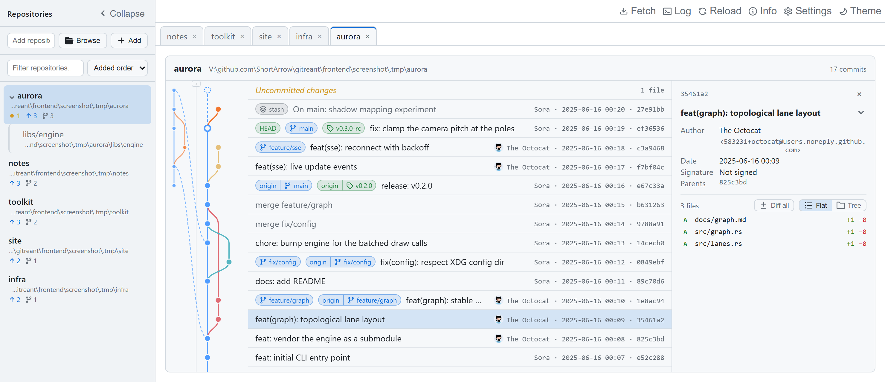

# gitreant

[](https://deepwiki.com/ShortArrow/gitreant)
[](https://crates.io/crates/gitreant)

<!-- [](https://github.com/ShortArrow/gitreant/releases) -->

[English](README.md) | [日本語](docs/README.jp.md)

<p align="center">
  
</p>

Manage, inspect, and maintain multiple Git repositories from one place.

Gitreant combines “Git” with “Treant,” a mythical guardian of the forest. The name represents a tool that watches over, organizes, and maintains a forest of Git repositories.

Pronunciation: /ˈɡɪt.triːənt/ (git-ree-ant)

A web app that shows commit graphs of local git repositories side by side in a
single-page app. Inspired by [k1LoW/mo](https://github.com/k1LoW/mo), it ships
as a single Rust binary with an embedded React SPA.

<picture>
  <source media="(prefers-color-scheme: dark)" srcset="docs/images/screenshot-dark.png">
  
</picture>

```console
$ gitreant                 # discover .git from the current directory
$ gitreant ../foo ../bar   # show multiple repositories at once
```

Running `gitreant` again from another directory adds that repository to the
already-running server, so everything appears on the same page
(single-instance behavior, like mo).

The launcher detaches by default: the server keeps running in the background
and control returns to your shell. Stop it with `gitreant --shutdown`, or use
`--foreground` to keep the server attached to the terminal.

## Features

- Commit graphs of several local repositories on one page, in tabs and two
  side-by-side panes
- Commit details and diffs: the full message, signature state, changed
  files, and inline or side-by-side diffs with intra-line highlights
- Work in progress at a glance: uncommitted changes above HEAD, linked
  worktrees, and line-ending-only changes named as such
- Fetch, check out, merge, create branches, and create or delete tags from
  the graph, each delegated to the git CLI
- Pull request links through `gh` and signature verification through `gpg`,
  both optional
- One self-contained binary, a command palette, dark and light themes, and
  an English or Japanese UI

Every feature in detail: [docs/FEATURES.md](docs/FEATURES.md).

## Install

On Windows, from WinGet:

```console
> winget install ShortArrow.gitreant
```

On Debian 12 or Ubuntu 22.04 and later, amd64 or arm64, from the APT
repository at `pkg.shortarrow.jp`
([ADR 0034](docs/adr/0034-debian-packages.md)):

```console
$ sudo curl -fsSL https://pkg.shortarrow.jp/apt/shortarrow-archive-keyring.gpg -o /usr/share/keyrings/shortarrow-archive-keyring.gpg
$ echo "deb [signed-by=/usr/share/keyrings/shortarrow-archive-keyring.gpg] https://pkg.shortarrow.jp/apt stable main" | sudo tee /etc/apt/sources.list.d/shortarrow.list
$ sudo apt update
$ sudo apt install shortarrow-archive-keyring gitreant
```

Installing `shortarrow-archive-keyring` by name keeps it, and the key that
verifies the repository, when gitreant is removed; later keys arrive with
`apt upgrade`. `gitreant --version` checks the install. The `.deb` files
on the GitHub Release do not install on their own, since they depend on
`shortarrow-archive-keyring`.

Anywhere with Rust (stable), from crates.io. The crate carries the built
frontend, so this needs no Node.js; on Linux it needs the Wayland client
headers (`libwayland-dev` on Debian and Ubuntu):

```console
$ cargo install gitreant
```

Every GitHub Release also carries the binaries for Windows, macOS, Linux
and Termux, with a `SHA256SUMS`. To build from source, see
[docs/CONTRIBUTING.md](docs/CONTRIBUTING.md#development-setup).

## Options

```
gitreant [PATH...]
  -p, --port <PORT>   port to listen on / connect to (default 4000); left out,
                      --shutdown, restart and refresh find the running server
      --no-open       do not open the browser automatically
      --app           open in a chromeless window instead of a tab (needs a
                      Chromium-based browser; falls back to the ordinary
                      browser without one, and --no-open outranks it)
      --foreground    run the server in the current terminal instead of detaching
      --shutdown      stop the running gitreant server and exit
      --all           with --shutdown, stop every running gitreant server

gitreant doctor       check the environment: git (required), gh and gpg
                      (optional feature enablers), and whether a server is
                      already running on the port; exits non-zero when a
                      required tool is missing
gitreant restart      restart the running server, keeping the repositories it
                      shows; a fresh process re-verifies every signature and
                      picks up a rebuilt binary
gitreant refresh      re-verify commit signatures in place, without restarting
                      (use after adding a key to your gpg keyring)
gitreant list         list the running servers, one line each: URL (with the
                      secret the page needs), pid, start time, version and how
                      many repositories each shows
  --verbose           also list each server's repositories, with how and when
                      each came (at startup, from the CLI or from the browser)
  --json              print all of it as JSON
gitreant editor list  list the editors a file opens with, kept in config.toml
                      under $XDG_CONFIG_HOME/gitreant (else ~/.config/gitreant)
gitreant editor add <name> <program> [args...]
                      add an editor, or replace the one of that name; {path}
                      and {line} in its arguments are filled in (on Windows,
                      name a .cmd launcher with its extension, as code.cmd)
gitreant editor remove <name>
                      remove an editor
```

## Contributing

See [docs/CONTRIBUTING.md](docs/CONTRIBUTING.md) for development setup,
architecture, and testing. Planned work lives in
[docs/ROADMAP.md](docs/ROADMAP.md).

## License

Licensed under either of the following, at your option:

- MIT License ([LICENSE-MIT](LICENSE-MIT))
- Apache License 2.0 ([LICENSE-APACHE](LICENSE-APACHE))

`SPDX-License-Identifier: MIT OR Apache-2.0`

Unless you explicitly state otherwise, any contribution intentionally
submitted for inclusion in this work by you, as defined in the Apache-2.0
license, shall be dual licensed as above, without any additional terms or
conditions.
